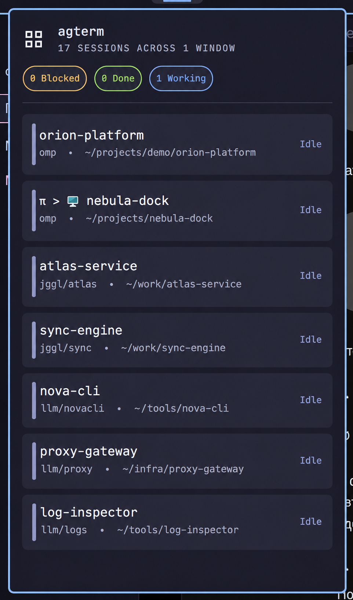

# agterm for Omarchy

An unofficial Omarchy bar plugin for [agterm-linux](https://github.com/melonamin/agterm-linux) that shows agent status across open agterm workspaces and lets you focus an existing session. It is not affiliated with or endorsed by the Omarchy or agterm-linux projects.

[](preview.png)

## Features

- Horizontal-bar and popup summaries for Working, Blocked (needs attention), and Done (finished), plus an offline indicator. Vertical bars show the icon and offline indicator rather than numeric bar counts.
- Opens a scrollable list of sessions across open agterm windows and workspaces; page sessions are excluded.
- Shows observed recent sessions first when usage timestamps are available, with deterministic status and name tie-breaks.
- Focuses an existing session/window; it does not create terminals or agents.
- Middle-click or Enter uses status-first attention ordering; right-click restarts the monitor.
- Uses supported agterm events with a 20-second safety snapshot and keeps its usage cache locally.
- Makes no network requests at runtime. The plugin and installer do not modify agterm or OMP configuration.

## Status sources and limits

The widget reads agterm's session data; it does not inspect agent conversations or independently detect agent lifecycle events.

| Display | Available status source |
| --- | --- |
| Working | Explicit agterm `active` status, or a recognized spinner in the terminal title when structured status is absent. |
| Blocked / needs attention | Explicit agterm `blocked` status. A spinner title alone cannot identify an approval or input wait. |
| Done / finished | Explicit agterm `completed` status. A spinner stopping does not establish completion. |
| Idle | Explicit `idle`, an unrecognized status, or no recognized activity signal. This is not proof that no agent is running. |

The title fallback recognizes only `π <frame>` or `<frame> π` at the beginning of agterm's `title`, with frames from `⠋⠙⠹⠸⠼⠴⠦⠧⠇⠏`. Explicit status takes precedence. Custom session names, selection flags, and foreground processes are not activity signals. Title changes are observed on event-triggered or 20-second safety snapshots; an old title left behind by an application can remain stale.

Counts are per terminal session, not detected main-agent processes. Workers and splits within one session do not add rows; multiple agents sharing one session are not counted separately. A session has one aggregate agterm status, so a waiting split can mark that session as needing attention. The plugin has no independent split/scratch-pane chooser.


## Requirements

- Omarchy with native Quickshell/Quattro plugin support, normally Omarchy 4.x. Older Omarchy compatibility is not claimed.
- Native agterm-linux with working `window list`, `tree`, `events`, `session select`, and `window select` commands. The exercised Linux build is `0.33.1+linux.1`; compatibility with every older release is not established.
- Python 3.10+ available as `python3`.
- Git for Git-based installation. Omarchy's plugin tooling also uses `jq`.

### Optional OMP adapter — live integration unverified

`integrations/omp-agterm-status.ts` provides an opt-in adapter for OMP lifecycle callbacks. Its callback behavior is tested with a simulated OMP context; real OMP-to-agterm hook delivery has not been verified. It is not required for the title-based Working fallback, and it is not installed or enabled by the plugin installer.

Prerequisites: a compatible OMP extension API, an executable agterm status wrapper at `~/.config/agterm/agent-status/agterm-agent-status.sh` (or `AGTERM_STATUS_COMMAND`), and a working current `agtermctl`. The wrapper is not supplied by this repository. Installing the adapter alone does not install or repair it. For custom OMP profiles or agent directories, use that runtime's actual extension-loading directory.

```bash
# Refuse to overwrite an existing adapter; review/back it up separately.
test ! -e "${HOME}/.omp/agent/extensions/agterm-status.ts" &&
  test ! -L "${HOME}/.omp/agent/extensions/agterm-status.ts" &&
  install -D -m 0644 integrations/omp-agterm-status.ts \
    "${HOME}/.omp/agent/extensions/agterm-status.ts"
```

The adapter invokes `~/.config/agterm/agent-status/agterm-agent-status.sh` using OMP's argument-array process API. It sets `AGTERMCTL` to `AGTERM_STATUS_CLI` or `agtermctl` on `PATH`, overriding any stale CLI path baked into an older wrapper. Set `AGTERM_STATUS_COMMAND` or `AGTERM_STATUS_CLI` in the OMP launch environment when the defaults do not match your installation. Restart OMP after installing or changing the extension.

The intended mapping is work → active, approval/`ask` waits → blocked, resolution → active, final settlement → completed, and shutdown → idle. Ordinary tool calls do not mean blocked. The adapter suppresses contexts identified as `ctx.agent.kind === "sub"` and does nothing without `AGTERM_SESSION_ID`; it is not a general worker-process detector. Completion uses agterm's `--auto-reset`, so visiting that session can clear Done back to Idle. Reporting failures are swallowed and may produce no visible status; verify delivery before relying on this integration.

Pi integrations use Pi's own extension-loading directory and API; this adapter is specifically for OMP. Do not install it into Pi's extension directory. The adapter does not repair or replace other agent integrations.

## Install with Omarchy

```bash
omarchy plugin add https://github.com/dmitriiweb/omarchy-agterm.git --enable
```

Review and trust the plugin before accepting Omarchy's confirmation prompt. Plugin code runs with your user permissions. For deliberate noninteractive automation, add `--yes`.

To place it immediately after the agents widget, when that reference widget is installed:

```bash
omarchy bar move dmitriiweb.agterm --after omarchy.agents
```

### Migrate an existing `local.agterm` install

If `local.agterm` is already installed, disable it first, then run the Git installation command above:

```bash
omarchy plugin disable local.agterm
omarchy plugin add https://github.com/dmitriiweb/omarchy-agterm.git --enable
```

The old plugin directory remains as a disabled backup. Settings are not migrated automatically; reapply `cliPath`, `showIdle`, and `showIcon` to `dmitriiweb.agterm` as needed.

### Manual copy installation

```bash
git clone https://github.com/dmitriiweb/omarchy-agterm.git
cd omarchy-agterm
./install.sh
```

The installer targets `${XDG_CONFIG_HOME:-$HOME/.config}/omarchy/plugins/dmitriiweb.agterm`, refuses to overwrite an existing directory, validates the manifest, rescans plugins, and attempts to enable the plugin. If validation or activation fails, the copied files remain for inspection. It attempts to place the plugin after `omarchy.agents`; this can move its bar position and only applies when the reference widget exists. Non-default XDG configuration discovery depends on the installed Omarchy version.

Plugin discovery is asynchronous. If activation reports that `dmitriiweb.agterm` is unknown after copying, allow discovery to finish, then run `omarchy-shell shell rescanPlugins` and `omarchy plugin enable dmitriiweb.agterm`.

This copy workflow has no Git-based `omarchy plugin update` path. To update it, back up or move the existing destination directory before rerunning the installer. The installer does not update in place or preserve bar placement for you; reapply the desired placement/settings as needed.

## Configuration

Configure these values in Omarchy's bar plugin settings:

| Setting | Default | Behavior |
| --- | --- | --- |
| `cliPath` | empty | Finds `agtermctl` on `PATH`, then checks standard install paths. An explicit path expands `~` and environment variables; for example `/home/your-user/.local/bin/agtermctl`. |
| `showIdle` | `true` | Includes idle sessions in the popup. It filters only the popup list, not bridge data or bar counts. |
| `showIcon` | `true` | Shows the icon on horizontal bars. Vertical bars always show it. |

## Usage

- Left-click the bar widget to toggle the popup.
- Click a popup row to focus that existing session and its window. Success closes the popup and refreshes usage; failure keeps it open with an error. Overlapping focus attempts are ignored.
- Middle-click the bar widget or press Enter in the popup to focus the first bridge-prioritized session: blocked, completed, active, then idle.
- Right-click the bar widget to restart the monitor.

The popup sorts by recency descending, then selected state, status (blocked, completed, active, idle), status-change time descending, and name. The attention action uses the bridge's separate status-first ordering. Page sessions are omitted. Usage is recorded after successful plugin focus; external selection is noticed only when a snapshot observes the changed selected session, so rapid selection changes between snapshots cannot be reconstructed.


## Updates and removal

For Git installs:

```bash
omarchy plugin update dmitriiweb.agterm
omarchy plugin remove dmitriiweb.agterm
```

An update that changes the installed checkout asks for confirmation; an already up-to-date checkout does not. Removal also asks for confirmation. Add `--yes` only for deliberate automation. Removing a Git install deletes the installed checkout, including local edits. The inspected Omarchy version moves a non-Git copy to a backup instead; do not assume the same removal behavior across versions. Plugin changes are rescanned/hot-reloaded without a full shell restart. After an in-place bridge replacement, right-click the widget to restart its monitor if it has not reloaded.

## Troubleshooting and privacy

- Check the native client directly: `agtermctl window list --json`.
- Validate an installed copy: `omarchy plugin validate <installed-path>`.
- From a repository checkout, inspect a snapshot with `python3 scripts/agterm_bridge.py snapshot`.
- The bridge reads local window, workspace, and agent status data through `agtermctl`. It stores usage timestamps in `${XDG_CACHE_HOME:-$HOME/.cache}/omarchy-agterm/usage.json`; event monitoring also takes a safety snapshot every 20 seconds. Snapshot/data errors and event-monitor errors are reported separately; partial tree failures preserve rows from readable windows.
- The plugin runtime makes no network requests. GitHub access is used by Git-based installation and updates, not by the running plugin.
- See [Status sources and limits](#status-sources-and-limits) before interpreting Idle or expecting Blocked/Done from title detection. A missing lifecycle report is not a widget-side indication that work has stopped.
- The optional OMP adapter is a separate, unverified-live integration described above. The plugin and installer never copy extensions, enable hooks, or alter OMP configuration automatically.

## Development

Architecture:

- `manifest.json` — native Omarchy plugin metadata and settings.
- `BarWidget.qml` — native Quickshell `Panel`, popup, display sorting, and interactions.
- `scripts/agterm_bridge.py` — standard-library-only CLI bridge, monitoring, cache, and explicit focus operation.
- `install.sh` — validated manual copy installer.
- `tests/test_bridge.py` — bridge data-boundary, ordering, and recency tests.
- `tests/test_bridge_process.py` — isolated fake-CLI focus, watch/recovery, and coordinated cache-writer tests.
- `tests/test_adapter.mjs` and `tests/test_adapter.py` — isolated adapter lifecycle tests, included in unittest discovery.
- `tests/agterm_e2e_support.py`, `tests/test_agterm_e2e.py`, and `tests/test_widget_e2e.py` — opt-in real-agterm fixtures, lifecycle checks, and native widget interaction tests.
- `integrations/omp-agterm-status.ts` — optional, manually installed OMP lifecycle adapter; separate from plugin installation.
- `assets/` — upstream SVG, derived light/dark PNG variants, and upstream asset license.

Verification commands:

```bash
PYTHONDONTWRITEBYTECODE=1 python3 -m unittest discover -s tests -v
python3 -m json.tool manifest.json
bash -n install.sh
omarchy plugin validate .
python3 scripts/agterm_bridge.py --help
```

The Python bridge has no third-party dependencies. The adapter tests require Node.js 18+; unittest discovery explicitly skips that group if `node` is unavailable. Run them separately with `node --test tests/test_adapter.mjs`.

Default bridge process tests use temporary configuration/cache directories and a fake `agtermctl` executable. Adapter tests execute the real adapter with a simulated OMP event context and controlled timers; they do not prove installed OMP hook delivery. The default regression suite does not focus live windows, set live agent status, or install/enable plugins. The explicitly opted-in tests below exercise real agterm sessions and a native QML harness.

### Opt-in real-agterm E2E tests

Run from an agterm terminal with a live Wayland desktop. These tests deliberately create and delete a uniquely named test workspace and synthetic sessions in the window identified by `AGTERM_WINDOW_ID`. They do not run real model agents, change existing session statuses, or install agent integrations. Synthetic statuses exercise agterm's real control socket, the bridge process, and, when enabled, the real native QML widget.

```bash
AGTERM_E2E=1 PYTHONDONTWRITEBYTECODE=1 \
  python3 -m unittest discover -s tests -p '*e2e.py' -v

# Also render the actual widget and invoke its native attention handler.
# Requires Omarchy, qs, and an unlocked Wayland desktop.
AGTERM_E2E=1 AGTERM_E2E_NATIVE=1 PYTHONDONTWRITEBYTECODE=1 \
  python3 -m unittest discover -s tests -p '*e2e.py' -v
```

Keep `AGTERM_SOCKET` and `AGTERM_WINDOW_ID` set explicitly. The normal regression suite skips these tests unless opted in. E2E bridge configuration/cache use temporary directories. The native harness renders the checkout's widget, not the installed bar copy, and limits its view to fixture session IDs so unrelated activity cannot change expected counts. Its test-only IPC invokes the real attention handler and asserts the selected session UUID; it does not prove physical Enter/mouse delivery, wheel/keyboard scrolling, vertical-bar behavior, or cross-window focus. It briefly selects a test session and attempts to restore the recorded selection. Normal completion and Python failures run UUID-scoped fixture cleanup; interruption, forced termination, or an unavailable agterm can leave test resources behind, and cleanup errors are reported.

The mixed-state scenario is two Working, one Blocked (needs attention), one Done (finished), and one Idle. Sleeping test commands and explicit `session status` writes synthesize these states; the tests do not run model agents or real approval/completion hooks. Coverage includes work → attention → resumed work → done → idle, event-driven refresh, recency-independent attention ordering, one-row-per-session behavior with a split, and a closed-session focus failure remaining visible.

See [AGENTS.md](AGENTS.md) for contributor checks and safety constraints.

## License and credits

The plugin source is MIT licensed; see [LICENSE](LICENSE). The SVG and its two derived PNG variants are covered by the upstream MIT license in [`assets/LICENSE`](assets/LICENSE), copyright © 2026 Umputun.

The exact original SVG source is [`agterm-grid-symbolic.svg`](https://github.com/melonamin/agterm-linux/blob/linux-port/agterm-linux/Resources/icons/hicolor/scalable/actions/agterm-grid-symbolic.svg) from [melonamin/agterm-linux](https://github.com/melonamin/agterm-linux), branch `linux-port`, blob SHA `af31e16152691f393a83ab5c026d2f15b3eda705`. The two small PNGs are rasterizations of that SVG with only the fill color adjusted for light/dark bar backgrounds; neither is a screenshot. See the [upstream license](https://github.com/melonamin/agterm-linux/blob/linux-port/LICENSE).
